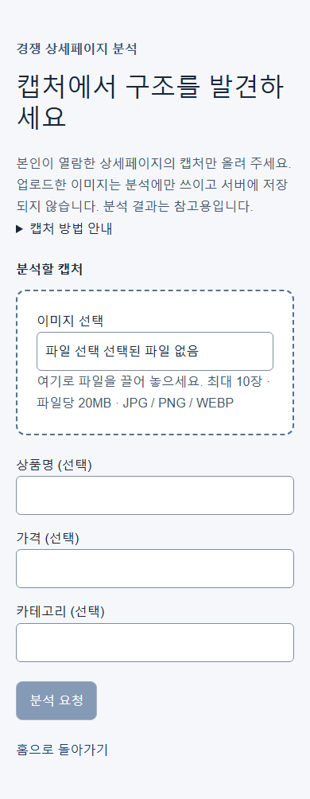
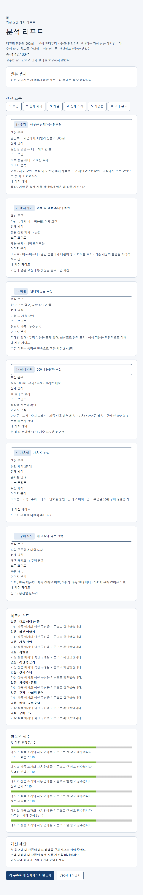
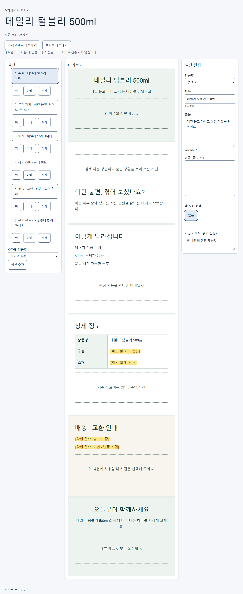

# Detail Page Studio

스마트스토어 판매자가 경쟁 상세페이지의 구조를 분석하고 자기 상품의 상세페이지를 만드는 로컬 웹 도구입니다. 1단계는 캡처 분석, 리포트와 JSON 내보내기, 한국어 초안 생성, 섹션·문구·사진 편집, PNG 내보내기를 제공합니다.

## 실행과 설정

Node.js 24를 사용합니다(정확한 버전은 [.nvmrc](.nvmrc)). `npm ci` 후 프로젝트 루트의 `.env.local`을 설정하고 `npm run dev`로 실행하세요. 설정을 바꾼 뒤 서버를 재시작하세요. 실제 인증 값은 문서나 저장소에 적지 마세요.

| 변수 | 용도 / 기본값 |
|---|---|
| `AI_PROVIDER` | 실제 AI 제공자: `openai`(기본) 또는 `anthropic` |
| `OPENAI_API_KEY` | OpenAI 선택 시 필요한 인증 값. 체험 모드에서는 불필요 |
| `ANTHROPIC_API_KEY` | 실제 AI 호출에 필요한 Anthropic 인증 값. 체험 모드에서는 불필요 |
| `AI_CLIENT` | `fake`이면 체험 모드, 그 외에는 실제 AI 사용 |
| `AI_MONTHLY_BUDGET_USD` | 월 사용액 상한(USD), 기본 30 |
| `AI_MAX_SLICES_PER_ANALYSIS` | 분석 1건의 이미지 조각 상한, 기본 24 |

[홈](http://localhost:3000)을 여세요. 실제 AI 설정이 없으면 분석·생성 요청에 503 `AI_NOT_CONFIGURED` 안내가 표시됩니다. `.env.local`은 Git 비추적 파일입니다.

## 체험 모드

`.env.local`에서 `AI_CLIENT` 값을 `fake`로 지정하면 인증 값이나 외부 AI 호출 없이 예시 결과로 전체 흐름을 체험할 수 있습니다. 분석 입력과 상품 정보 입력 상단에 체험 모드 배너가 표시됩니다. 예시 결과는 실제 업로드 내용을 분석한 결과가 아닙니다.

## 사용 순서

1. **경쟁 상세페이지 캡처 업로드**: `/analyze`에서 본인이 열람한 상세페이지의 JPG / PNG / WEBP를 선택합니다. 최대 10장, 파일당 20MB이며 여러 장은 위에서 아래 순서로 정렬하세요.
2. **분석 리포트 확인**: 섹션 구조, 핵심 문구, 이미지 구성, 사진 가이드, 체크리스트, 점수와 개선 제안을 확인하고 JSON으로 내보냅니다. 분석 결과는 참고용입니다.
3. **리포트 구조로 내 상세페이지 만들기 / PNG 내보내기**: 리포트에서 제작 화면으로 이동하거나 `/create`에서 시작합니다. 상품명·특징과 내 사진의 설명으로 초안을 만들고 섹션 순서·문구·템플릿·사진을 편집합니다. 확인 필요 문구를 검토한 뒤 전체 또는 섹션별 PNG를 내려받으세요. 출력 폭은 860px이며 긴 페이지는 자동 분할할 수 있습니다.

최근 리포트와 초안은 같은 브라우저에서 다시 열 수 있습니다. 브라우저 저장소 삭제 시 작업이 사라질 수 있으므로 필요한 결과는 내보내 보관하세요.

## 캡처 방법과 화면 예시

PC Chrome에서 개발자 도구 → 명령 메뉴 → `Capture full size screenshot`을 사용합니다. 모바일에서는 스크롤 캡처 기능을 사용하세요. 개인정보와 불필요한 영역은 제외하고 본인이 열람한 페이지만 업로드하세요. 서버는 스마트스토어 페이지를 자동 수집하지 않습니다.

가상 상품으로 찍은 화면 예시입니다.





## 데이터 처리 원칙

[DEC-007](docs/09-DECISIONS.md)에 따라 경쟁 캡처는 분석에만 쓰고 제작 결과에 넣지 않습니다. 업로드 이미지는 분석 처리 중 AI에 전달되며 서버에 저장하지 않습니다. 리포트의 원본 이미지는 브라우저 세션에서만 표시됩니다.

내 사진은 브라우저에만 보관하며 서버에는 사진 설명만 보냅니다. 영구 저장이 불가능하면 새로고침 시 사진이 사라진다는 안내가 표시됩니다. 생성 문구는 경쟁 문구 자체가 아니라 구조와 전개 방식을 참고하며 유사도 검사와 확인 필요 경고를 제공합니다.

실제 상품 이미지, 경쟁 캡처와 결과물 이미지는 GitHub에 올리지 않습니다. 로컬 보관은 Git 비추적 `private/`를 사용하세요. 저장소의 캡처와 테스트 자료에는 가상 상품만 사용합니다. 코드의 공개 여부와 이미지 비공개 원칙은 별개입니다.

## 비용 안내

실제 AI는 선택한 제공자의 API 사용 비용이 발생하며 구독 CLI 로그인과 별도입니다. 100만 토큰당 입력 / 출력 추정 단가는 OpenAI(gpt-6-luna) USD 0.10 / 0.50, Anthropic(claude-opus-5-5) USD 4 / 20이며 캐시 할인은 반영하지 않습니다. 서버는 `.data/usage.json`에 사용량을 기록하고 월 상한(기본 USD 30)에 도달하면 다음 요청을 거부합니다. 요청 전 누적 사용액 기준이므로 진행 중 요청 비용까지 엄격하게 제한하지는 못합니다. 파일 삭제나 여러 서버 실행 시 집계가 달라질 수 있습니다. 상한 인상은 Human 승인 대상입니다. 체험 모드는 실제 AI 비용이 발생하지 않습니다.

## 개발 문서

- 진행 상태: [docs/07-TASKS.md](docs/07-TASKS.md)
- 작업 규칙: [AGENTS.md](AGENTS.md)
- Harness 실행: [docs/12-ORCHESTRATOR-DESIGN.md](docs/12-ORCHESTRATOR-DESIGN.md)

## 로컬 검증

`next-env.d.ts`는 Next.js가 생성하며 Git에서 제외합니다. 테스트는 Fake를 사용하며 실제 외부 AI를 호출하지 않습니다.

개별 검사: `npm run lint`, `npm run typecheck`, `npm test`, `npm run build`.
운영 모드는 Build 후 `npm start`로 실행합니다.

```bash
bash scripts/verify.sh     # 또는 PowerShell: ./scripts/verify.ps1
```

전체 검증은 Harness Test 이후 npm ci → lint → typecheck → test → build 순서로 실행합니다.

- [프로젝트 범위](docs/01-PROJECT.md), [승인 계획](docs/06-PLAN.md), [승인 결정](docs/09-DECISIONS.md)
- [작업 기록](docs/08-WORK_LOG.md), [Multi-Agent 정책](docs/11-MULTI-AGENT-ORCHESTRATION-POLICY.md)

## 다음 단계

2단계에는 네이버 커머스 API로 **내 스토어** 상품을 가져와 진단·비교하는 기능을 계획하고 있습니다. 커머스 API 연동, 로그인과 배포는 현재 범위 밖입니다.
