# 08. Work Log

완료된 작업, 오류, 해결 과정의 누적 기록이다. 최신 항목을 아래에 추가한다.

---

## 2026-11-03 — Harness 뼈대 구성 (DEC-001)

- MoodFit v3(today-v3)에서 Orchestrator / Harness 자산을 복사하고 MoodFit 의존성을 제거했다.
  - 제거: AWS Profile Preflight(`aws-preflight.mjs`, Test, Fixture), Contract `aws_profiles`, 배포 / IaC / Staging · Production Script와 Workflow, MoodFit Task · 문서 · 이미지
  - 변경: Git 자동화 활성 조건을 Task 번호(≥ 22)에서 `harness/config.local.json`의 `git_automation`으로 변경, PR Gate Required Check를 `frontend` / `backend`에서 `verify`로 변경, 임시 경로 / Lock 이름의 `moodfit-` 접두사를 `harness-`로 변경
  - 재작성: AGENTS.md, docs/01 · 03 ~ 09 · 11 · 12, docs/tasks/COMMON.md, scripts/verify.*, .github/workflows/ci.yml
- Verification: `node --test scripts/orchestrator/*.test.mjs` 통과

---

## 2026-11-03 — TASK-001 Requirements / Gate A 초안 (Claude Code 세션)

- Repository 생성(Human) 후 첫 Commit을 `main`에 Push했다. `.gitattributes`로 줄바꿈 정책을 고정했다.
- DEC-006(분석 순서: 남의 스토어 → 내 스토어) 기록.
- DEC-003 조사: `smartstore.naver.com/robots.txt`가 모든 일반 봇을 `Disallow: /`로 막고, `shopping.naver.com/robots.txt`가 AI / RAG 목적 접근을 명시적으로 금지함을 확인했다. 서버 URL 수집 권장안을 철회하고 "1단계 캡처 업로드 + 2단계 커머스 API"로 갱신했다.
- DEC-002(Next.js + TypeScript), DEC-004(Claude Opus 5.5 + Fake Client), DEC-005(Ruleset) 권장안 작성. 모두 Human 승인 대기.
- docs/01 · 03 · 04 · 05 · 06 초안, TASK-002 Task 문서와 JSON Contract 작성. Contract는 Schema / 경로 검증을 통과했다.

---

## 2026-11-03 — TASK-001 완료

- Human이 DEC-002 ~ DEC-005와 docs/01 · 03 ~ 06을 승인했다. Merge 권한을 Claude Code 세션에 위임했다(DEC-008).
- 월 AI 비용 상한은 금액 지정이 없어 기본값 USD 30으로 기록했다.
- Codex Sandbox(workspace-write)에서 npm Registry 접근이 되지 않음을 확인했다. TASK-002 Dependency 설치는 Claude 세션이 Task Branch에 먼저 Commit한다.

---

## 2026-11-03 — TASK-002 Executor 구현

- App Router의 홈, 분석 / 제작 준비 중 페이지와 한국어 레이아웃을 구성했다. 홈에는 두 진입 링크와 최근 작업 빈 상태를 표시한다.
- TypeScript strict, Tailwind PostCSS, ESLint, Vitest / Testing Library 설정과 홈 렌더링 Test를 추가했다.
- npm 실행 Script 및 두 verify Script에 Harness 다음 npm ci / lint / typecheck / test / build 단계를 추가했다.
- 승인된 직접 의존성 17개의 Version이 Lockfile과 일치함을 확인했다. Dependency / Lockfile 변경 없음.
- Verification: `bash scripts/verify.sh` 실행에서 Harness Test 101개 통과 출력 확인. Executor가 실행 중 중단 입력을 보내 전체 Script는 exit 1로 종료했으며 전체 검증 성공으로 처리하지 않는다.
- 추가 설치 확인: `npm ci --offline --ignore-scripts --fetch-retries=0`은 npm 캐시에 eslint Registry 응답이 없어 ENOTCACHED로 종료했다. Sandbox의 네트워크 제한과 미설치 의존성으로 앱 lint / typecheck / test / build 및 dev 경로 확인은 실행하지 못했다. 승인된 ESLint 10에 대한 하위 eslint-plugin-import의 peer 범위 경고도 출력되었으며 실제 호환성은 Orchestrator 검증에서 확인해야 한다.
- (Executor 기록은 Sandbox 안의 중간 상태다. 최종 결과는 아래 Orchestrator / Claude 세션 기록을 따른다.)

## 2026-11-03 — TASK-002 Verification / 완료 (Orchestrator + Claude 세션)

- Orchestrator Run `2026-11-03T04-49-37-630Z-a81c8ebe`: Sandbox 밖 `bash scripts/verify.sh` 성공 — Harness 101/101, npm ci, lint(0 error), typecheck, vitest 1/1, next build(`/`, `/analyze`, `/create` 정적 생성). Claude Reviewer 1회차 PASS(비차단 Finding 6건). Draft PR #2 자동 생성.
- Claude 세션 후속 처리(Finding 반영):
  - F-002: `postcss.config.mjs` 익명 default export 경고 해소.
  - 추가 발견: ESLint / TypeScript가 `.harness/workspaces/`의 Worktree 사본까지 검사해 같은 경고가 중복되었다. `eslint.config.mjs` ignore와 `tsconfig.json` exclude에 `.harness`를 추가했다.
  - F-003(vitest 설정 ESM 경고), F-004(eslint-config-next 하위 Plugin의 ESLint 10 peer 경고), F-005(예시 리포트 링크)는 후속 Task에서 처리한다.
  - `scripts/capture-screens.mjs` 추가: Chrome DevTools Protocol로 정확한 폭(390 / 768 / 1280)의 화면을 캡처한다(외부 Dependency 없음). headless Chrome의 `--window-size`는 500px 미만 폭에서 화면이 잘리는 문제가 있어 직접 작성했다.
- `npm run start` 후 `/`, `/analyze`, `/create` 모두 HTTP 200 확인.

---

## 2026-11-03 — TASK-003 Executor 구현

- AiClient 계약, 오류 코드, 요청 기록 / 응답 큐 / 비동기 응답 함수 / Schema 검증을 갖춘 Fake를 추가했다.
- Anthropic 구현은 승인된 모델과 Structured Output을 사용하며 이미지 블록, 기본 medium effort, SDK 타입 기반 오류 매핑을 처리한다. SDK 기본 환경변수를 사용하며 자동 재시도는 비활성화했다. 실제 API는 호출하지 않았다.
- 승인된 입력 / 출력 단가 계산, UTC 월별 비용 Guard, 메모리 및 JSON 파일 저장소를 추가했다. 파일 갱신은 같은 프로세스 안에서 직렬화하고 임시 파일 후 rename으로 기록한다. 손상된 사용액 파일은 초기화하지 않고 오류를 전파한다.
- createAiClient는 환경설정에 따라 Fake 또는 Anthropic을 선택하고 호출 전 한도 확인 / 성공 후 사용액 기록을 적용한다. Fake는 파일을 쓰지 않는다.
- 참고 검증: npm run lint, npm run typecheck 통과. npm test는 3개 파일 / 19개 Test 통과(기존 화면 Test 포함). SDK 요청 형태, 오류 매핑, Fake 계약, 비용 차단, UTC 월 경계, 임시 디렉터리 파일 영속성과 동시 갱신을 검증했다.
- bash scripts/verify.sh 실행: Harness 101개 Test 통과 후 npm ci 단계에서 장시간 대기하고 기존 ESLint peer 의존성 경고를 출력했다. 중단 입력으로 종료되지 않았고 프로세스 종료 요청도 Sandbox의 Access denied로 거부되었다. 전체 Script 성공으로 처리하지 않는다. 이 Worktree에는 로컬 node_modules가 없어 앱 개별 검증은 상위 Repository의 설치본을 사용했다.
- npm run build는 Turbopack이 Worktree 루트 안에서 next/package.json을 찾지 못해 실패했다. 설치 경계에 따른 환경 제한이며 앱 Build 성공 증거는 아니다. Sandbox 밖 Orchestrator Verify 결과가 최종 검증 기준이다.
- 최종 검증 기록(F-003 제공 Orchestrator Verify 결과): Sandbox 밖 `bash scripts/verify.sh`가 exit 0으로 종료했다. Harness 101개 Test, lint, typecheck, Vitest 19개 Test, next build가 모두 통과했다. 위 Executor Sandbox의 대기 / Build 실패 기록은 중간 참고 기록이며, 최종 검증 결과는 이 Orchestrator 성공 기록으로 대체한다.
- git diff --check, 추가 코드 Secret Guard, SDK import 경계 및 변경 문서 인코딩 검사를 통과했다. Task 상태는 IN_PROGRESS로 유지하며 검증 / Review / Merge 완료를 선언하지 않는다.
- 잔여 제한: 월 한도는 이미 누적된 사용액을 기준으로 다음 호출을 차단한다. 진행 중 호출의 비용 예약과 여러 프로세스 간 파일 잠금은 제공하지 않는다.

## 2026-11-03 — TASK-003 완료 (Orchestrator + Claude 세션)

- 1차 Run은 Preflight에서 BLOCKED: Task 문서의 토큰 수 필드 표기가 Secret Guard의 할당 규칙에 오탐되었다. 필드명을 input / output으로 바꾸고 Executor 작성 주의를 추가한 뒤 재실행했다.
- 2차 Run `2026-11-03T05-05-17-264Z-569b6a73`: Review 2회차 PASS, Orchestrator Verify 성공, Draft PR #3 자동 생성.
- Claude 세션 후속 처리: R-001 반영 — `AI_MONTHLY_BUDGET_USD`가 빈 문자열이면 기본값 30을 쓰도록 수정하고 Test를 추가했다. R-002(계약 밖 SDK 오류는 원형 전달)는 TASK-005 / 007 API Route에서 일반 오류로 감싸 처리한다.

## 2026-11-03 — TASK-004 Executor 구현

- UploadedImage / AnalysisSlice / ImageError와 공개 API를 추가했다. 장수, MIME, 실제 형식, 선언 크기와 Buffer 크기, 최소 너비를 검사한다. metadata 검사에 픽셀 디코딩 검사를 더해 헤더만 남은 손상 이미지도 거부한다.
- 이미지별 EXIF 회전과 비확대 축소 후 겹침을 둔 세로 조각을 JPEG로 인코딩한다. 알파는 흰 배경으로 처리한다. 원본 좌표는 EXIF 방향을 반영한 원본 표시 좌표이며 축소 전 높이로 환산한다. 전체 조각 수를 먼저 계산해 환경변수 / 옵션 상한을 초과하면 현재 수와 상한을 안내한다.
- 생성 이미지로 형식 / 장수 / 크기 경계, 위조 / 손상, 축소 좌표와 겹침, 마지막 조각, 여러 장 순번, 상한, 줄무늬 내용, EXIF / 투명 배경을 검증했다. 이미지 파일과 Dependency 변경은 없다. API / UI / 외부 호출은 추가하지 않았다.
- 참고 검증: lint, typecheck, 전체 Vitest 4개 파일 / 31개 Test 통과(이미지 Test 12개 포함). git diff --check 통과.
- Executor Sandbox 중간 관찰: `bash scripts/verify.sh`는 Harness 101개 Test 통과를 출력했으나 대기 중 보낸 중단 입력의 영향으로 exit 1 종료했다. npm ci 이후 앱 단계까지 완료한 결과가 아니며 최종 검증 결과가 아니다.
- Executor Sandbox 중간 관찰: 별도 `npm run build`는 Worktree 내부 next/package.json을 찾지 못해 실패했다. 로컬 node_modules에 next가 없고 개별 검사는 상위 Repository 설치본으로 실행된 설치 경계의 환경 제한이다.
- 최종 검증 기록(R-004 제공 Orchestrator Verify 결과): Sandbox 밖 검증에서 lint, typecheck, Vitest 31개 Test, next build가 모두 exit 0으로 통과했다. 위 Executor Sandbox 관찰은 중간 참고 기록이며 최종 검증 기준은 이 Orchestrator 결과다. 아래 Rework 변경분은 이후 Orchestrator 검증 대상이다.
- Rework R-001 ~ R-004: READY 상태 정의 복원과 Current Task IN_PROGRESS 동기화, 분할 계획의 너비 / 높이를 명시한 resize로 반올림 차이 제거, 1721×5999 홀수 비율 회귀 Test 추가, 검증 기록 정정.
- Rework Executor 참고 검증: 이미지 Test 13개, lint, typecheck, git diff --check 통과. 변경 문서의 연속 물음표 / U+FFFD 검사 통과. `bash scripts/verify.sh`는 실행했으나 Harness 단계에서 아직 종료 결과를 얻지 못했으며 전체 성공으로 보고하지 않는다. Rework 최종 검증 기준은 이후 Orchestrator Verify다.
- Task는 IN_PROGRESS로 유지한다. Executor 구현 완료는 Task 승인 / Merge 완료를 뜻하지 않는다.

## 2026-11-03 — TASK-004 완료 (Orchestrator + Claude 세션)

- Run `2026-11-03T05-20-01-988Z-2abe4abe`: Review 2회차 PASS, Orchestrator Verify 성공(Vitest 32개), Draft PR #4 자동 생성.
- Claude 세션 후속 처리: R-101 반영 — 최소 너비 검사에 EXIF 방향(5 ~ 8은 가로 / 세로 교체)을 적용하고 회전 이미지 Test를 추가했다. R-102(잘못된 조각 상한 설정의 오류 분류)는 TASK-005 API Route에서 서버 설정 오류로 처리한다.

## 2026-11-03 — TASK-005 Executor 구현

- DEC-009의 역할 / 이미지 종류 enum, 고정 체크리스트 10항목, 점수 6항목 및 제안 3~7개를 Schema와 한국어 Prompt에 반영했다. 체크리스트와 점수는 중복 항목도 거부한다.
- 업로드 검증과 분할 후 전체 조각을 한 번의 high effort 요청으로 전달한다. 서버가 UUID / 생성 시각 / 사용량 비용과 원본 좌표를 붙이며 범위 밖 시작 조각은 유효 경계로 보정한다.
- multipart Handler는 업로드 순서와 선택 입력 100자 제한을 처리한다. ImageError / AiError를 계약 상태로 매핑하고 설정 / 알 수 없는 오류는 내부 정보 없는 500으로 반환하며 서버에만 기록한다. 분할 상한 환경설정 오류도 서버 오류로 구분한다.
- 요청 시 생성하는 Node.js Route와 가상 상품 데일리 텀블러 500ml 샘플 응답을 추가했다. 이미지와 조각은 파일에 보관하지 않고 응답에는 좌표만 넣는다. Dependency / API Contract / UI 변경과 실제 API 호출은 없다.
- Executor 참고 검증: lint, typecheck, 전체 Vitest 5개 파일 / 47개 Test 통과(분석 Test 15개). Fake Route의 이미지 한 장 200 응답, 조각 순서, 경계 보정, 비용, Schema 오류, 각 오류 상태, 내부 메시지 비노출을 확인했다.
- 별도 npm run build는 Worktree 안의 next/package.json을 찾지 못해 실패했다. 해당 경로에 설치본이 없는 환경 제약이며 Build 성공으로 처리하지 않는다. 개별 검사는 상위 Repository 설치본을 사용했다.
- bash scripts/verify.sh는 Harness 101개 Test 통과 후 npm ci 단계에 진입했으며 아직 종료 결과를 얻지 못했다. 전체 성공으로 보고하지 않는다. 최종 검증 기준은 Sandbox 밖 Orchestrator Verify다.
- git diff --check, 추가 코드 / 문서의 Secret 검사와 연속 물음표 / U+FFFD 인코딩 검사를 통과했다.
- Task는 IN_PROGRESS로 유지한다. Executor 구현 완료는 Task 승인 / Merge 완료를 뜻하지 않는다.

## 2026-11-03 — TASK-005 완료 (Orchestrator + Claude 세션)

- Run `2026-11-03T05-36-16-421Z-4b0872b7`: Review 1회차 PASS(Finding 없음), Orchestrator Verify 성공, Draft PR #5 자동 생성.
- Claude 세션 Smoke: `AI_CLIENT=fake`로 `next start` 후 가상 이미지(860×3000, `private/` 보관) POST → 200 샘플 리포트(섹션 2, 점수 6, 체크리스트 10, sourceSlice 좌표 정상). 이미지가 아닌 파일을 image/png로 위조 → 400 INVALID_IMAGE.
- Claude 세션 후속 수정: 조각 라벨이 1부터 세는 번호만 보여 주어 0부터 세는 `sliceIndex`와 어긋날 수 있었다. 라벨에 `sliceIndex=n`을 함께 표시하도록 바꿨다.

## 2026-11-03 — TASK-006 Executor 구현

- 분석 입력에 다중 파일 선택 / 드롭, 썸네일, 순서 변경 / 삭제, 10장 / 파일당 20MB 제한, 선택 상품 정보, 이용 / 캡처 안내를 구현했다. FormData 요청과 경과 시간 / 예상 단계, 취소, 오류 코드별 안내 및 이미지 유지 재시도를 제공한다.
- 리포트 JSON은 브라우저 저장소에 최신순 최대 20개만 보관한다. 저장소 예외와 잘못된 데이터는 안전하게 처리하고 Schema로 리포트 필드만 저장한다. 원본 이미지는 메모리 Object URL만 사용하며 새 분석 시 이전 URL을 해제한다.
- 6개 섹션의 가상 상품 예시, 리포트 요약 / 타깃 / 톤 / 총점, 원본 위치 표시와 카드 이동, 한국어 역할 / 이미지 이름, 체크리스트 10항목 / 점수 6항목 / 개선 제안 / JSON 다운로드, 최근 작업을 추가했다. 1024px 기준으로 원본과 섹션을 가로 / 세로 배치한다.
- Executor 참고 검증: lint, typecheck 통과. Vitest 9개 파일 / 57개 Test 통과. 저장 순서 / 20개 상한 / 저장소 오류, 업로드 순서 / 삭제 / 성공 후 저장과 이동 / 오류 유지 / 취소, 예시와 없는 리포트, 최근 작업, 메모리 URL 교체를 확인했다.
- Orchestrator 최종 검증(F-002 제공 결과): Sandbox 밖 `bash scripts/verify.sh` 전체 실행 성공. lint, typecheck, Vitest 57/57, next build 및 Harness Test가 모두 통과했다.
- F-001 Rework: 원본의 자연 너비 / 높이로 서버 기본 분할 계획(860 / 1400 / 겹침 80)을 재구성하여 전역 조각 번호를 원본 이미지에 연결했다. 긴 원본의 후속 조각과 여러 원본, 이미지 로드 순서, 축소 좌표 및 카드 / 타임라인 스크롤 회귀 Test를 추가했다. 이 수정 이후 검증 결과는 별도로 확인한다.
- Rework 참고 검증: lint, typecheck, Vitest 9개 파일 / 58개 Test 및 `git diff --check` 통과. 변경 문서의 연속 물음표와 U+FFFD가 없음을 직접 확인했다.
- 화면 캡처 / 실제 390·768·1280 폭 검토는 Task Contract에 따라 Claude 세션이 수행하고 docs/images/task-006/에 추가해야 한다. Executor 허용 경로에는 이미지 폴더가 없어 캡처를 기록하지 않았다.
- git diff --check와 변경 파일의 연속 물음표 치환 흔적 / U+FFFD 직접 검사를 통과했다.
- Task 상태는 IN_PROGRESS로 유지한다. Executor 구현 완료는 Task 승인 / Merge 완료를 뜻하지 않는다.

## 2026-11-03 — TASK-006 완료 (Orchestrator + Claude 세션)

- Run `2026-11-03T05-48-24-969Z-8bf85d68`: Review 2회차 PASS, Orchestrator Verify 성공, Draft PR #6 자동 생성.
- Claude 세션 후속 처리:
  - N-001: 예시 리포트의 `sourceSlice.index`를 기본 분할(1400px, 겹침 80px → 1320px 간격)에 맞게 계산하고, 섹션별 핵심 문구 / 이미지 분석 / 사진 가이드를 서로 다르게 채워 예시답게 보강했다.
  - N-002: JSON 내려받기에서 Object URL 해제를 다음 Tick으로 미뤘다.
  - Vitest 58개 통과. `AI_CLIENT=fake`로 `next start` 후 캡처.

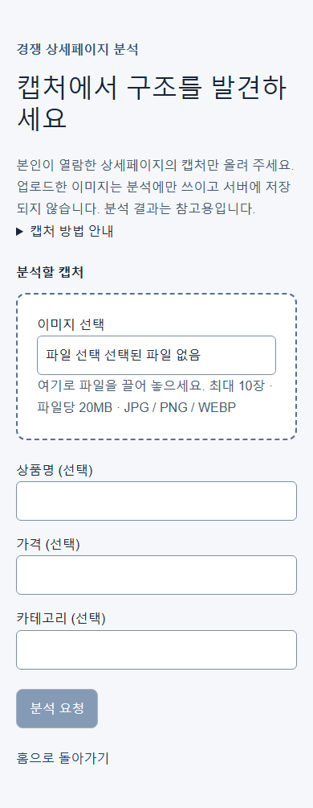
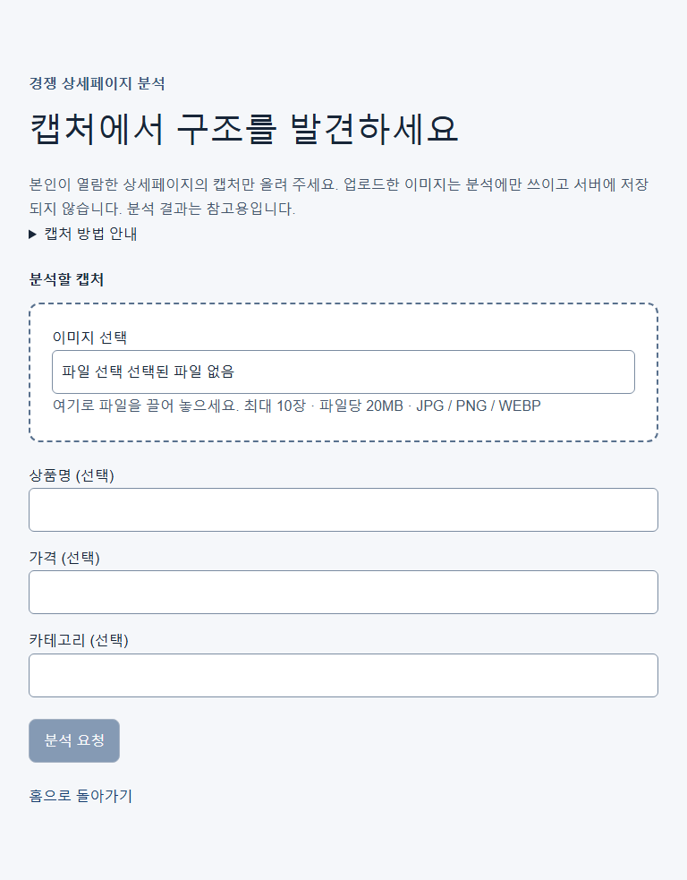
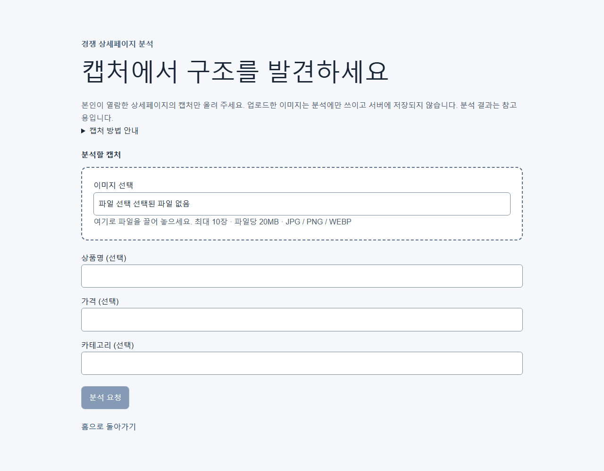
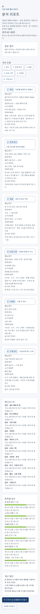
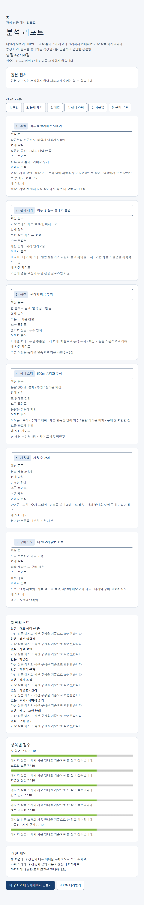
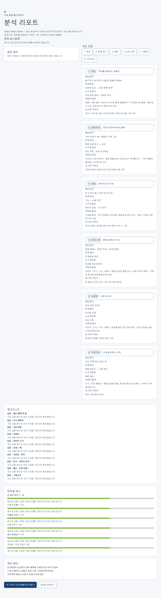
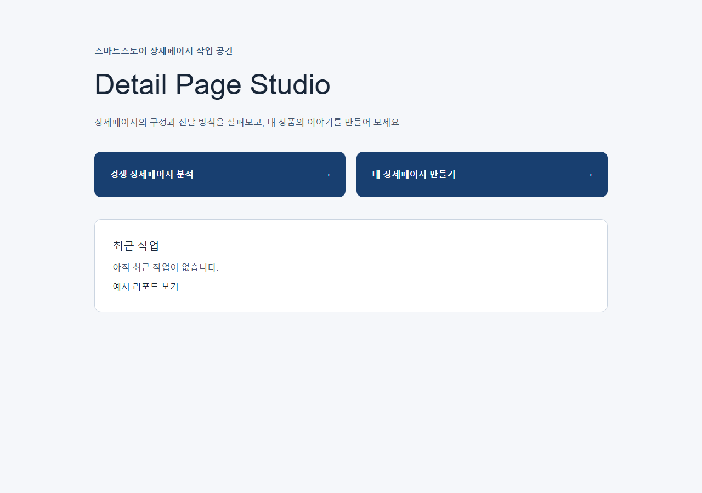

## 2026-11-03 — TASK-007 Executor 구현

- DEC-010에 따라 상품 정보와 사진 설명, 선택 분석 리포트로 초안을 생성하는 Schema / 한국어 Prompt / 엔진 / JSON Handler와 Node.js Route를 구현했다. 분석 리포트의 섹션 Schema를 재사용하며 API의 sourceSlice 형태를 받는다.
- 공백·문장부호 제거 및 영문 소문자화 후 경쟁 문구 연속 12자 이상 공통 구간을 검사한다. 내 상품 이름·특징에 포함된 구간은 제외하고, 위반 시 한 번 재생성한다. 재생성 후 위반은 섹션·필드·구간별 경고로 남긴다.
- 모든 호출 사용량과 비용을 합산하고 초안 / 섹션 UUID를 발급한다. 길이 초과와 금지 표현은 원문을 보존하면서 경고한다. 없는 사진 순번은 null로 보정하며 대표 사진을 먼저 배정하고 사진당 최대 두 섹션 사용을 적용한다.
- 가상 데일리 텀블러 500ml의 여섯 템플릿 샘플과 fake Route 테스트를 추가했다. 분석 / 생성 Handler가 공통 오류 응답을 사용하며 내부 예외 메시지는 응답에서 숨긴다. 실제 API 호출, Dependency, UI 변경은 없다.
- Executor 최종 참고 검증: 대표 사진 우선 배정 보강 이후 lint / typecheck 통과, 전체 Vitest 10개 파일 76개 Test 통과. 요청 경계, 유사도 / 고유 정보 예외 / 재생성 / 사용량 합산, 사진 배치 / 경고 원문 보존, Handler 오류 매핑 / 내부 메시지 비노출, fake Route를 확인했다.
- bash scripts/verify.sh는 Harness 101개 Test 통과 후 npm ci 단계에 진입했다. 아직 전체 종료 결과를 얻지 못했으므로 전체 성공으로 처리하지 않는다.
- 별도 npm run build는 Worktree 내부 next/package.json 설치본을 찾지 못해 실패했다. 개별 검사는 상위 Repository 설치본으로 실행되었다. 최종 검증 기준은 Sandbox 밖 Orchestrator Verify다.
- Task는 IN_PROGRESS로 유지한다. Executor 구현 완료는 검증 성공이나 Task 완료 승인을 대신하지 않는다. 승인된 역할의 Git / PR / Merge 후속 처리가 남아 있다.
- git diff --check 통과. 변경 문서와 신규 파일을 직접 읽어 연속 물음표 치환 흔적 및 U+FFFD가 없음을 확인했다.

## 2026-11-03 — TASK-007 완료 (Orchestrator + Claude 세션)

- Run `2026-11-03T06-09-12-653Z-20ea9883`: Review 1회차 PASS, Orchestrator Verify 성공(Harness 101, lint, typecheck, Vitest 76, build). 위 Executor 기록의 npm ci 대기 / build 실패는 Sandbox 중간 기록이며 최종 결과는 이 Verify다(F-001).
- Claude 세션 Smoke(`AI_CLIENT=fake`, `next start`): 정상 요청 → 200 초안(템플릿 6종, hero에 내 사진 0번 배치, warnings 없음), 빈 상품명 → 400 INVALID_REQUEST.
- F-002: 공통 오류 함수로 옮기면서 analyze 오류 문구가 일반화되었다(코드 / 상태는 동일). 화면 문구는 TASK-006 labels의 코드별 안내를 쓰므로 영향이 없다.

## 2026-11-03 — TASK-008 Executor 구현

- 상품명 / 특징 / 타깃 / 가격대와 내 사진 설명, 선택한 저장 리포트 또는 예시 리포트로 생성 API를 호출한다. 사진은 브라우저에 남기고 요청에는 순번과 설명만 포함한다. 진행 / 취소 / 오류, 참고 리포트 사전 선택, 사진 순서 변경 / 삭제를 제공한다.
- 초안은 사진을 제외하고 localStorage에 최신 수정순 최대 20개 저장한다. 내 사진 Blob과 설명은 IndexedDB의 dps / photos에 저장한다. 접근 또는 쓰기 실패 시 메모리로 대체하고 새로고침 시 소실 안내를 표시한다.
- 860px 템플릿 6종, 사진 가이드 자리 표시, 스펙 2열 표, 확인 필요 문구 강조와 내보내기용 data-detail-page 루트를 구현했다. 편집기는 섹션 순서 / 추가 / 삭제, 문구 / 템플릿 / 내 사진 변경, 즉시 미리보기, 500ms 자동 저장과 저장 실패 안내를 제공한다. 1024px 미만에서는 섹션 / 미리보기 / 편집 탭을 사용한다.
- 홈에서 초안과 리포트를 구분하며 기존 리포트의 제작 연결 경로를 유지했다. PNG 내보내기는 TASK-009 범위이므로 비활성 안내만 제공한다.
- Executor 최종 참고 검증: lint / typecheck, 전체 Vitest 14개 파일 88개 Test 및 git diff --check 통과. 요청에 사진 파일이 없는지, 사전 리포트 선택, 사진 정렬 / 삭제와 취소 후 늦은 응답 무시, 초안 저장 예외, 템플릿 / 표 / 강조, 섹션 편집과 자동 저장 / 실패 및 길이 안내를 확인했다.
- bash scripts/verify.sh는 Harness 101개 Test 통과 후 npm ci에서 npm 레지스트리 접근 EACCES로 중단됐다. 별도 build는 worktree 내부 next/package.json 설치본을 찾지 못해 실패했다. 개별 앱 검사는 상위 Repository 설치본으로 실행되었다. 전체 성공으로 처리하지 않으며, 최종 검증 기준은 Sandbox 밖 Orchestrator Verify다. 재설치나 권한 우회는 하지 않았다.
- 변경 문서와 신규 파일의 UTF-8을 직접 읽어 연속 물음표 치환 흔적과 U+FFFD가 없음을 확인했다.
- Task는 IN_PROGRESS로 유지한다. Executor DONE은 Task 완료 승인 / Merge를 대신하지 않는다. 허용 경로 밖의 화면 캡처는 Contract에 따라 Claude 세션이 입력 / 편집기 각 390 / 768 / 1280 폭에서 수행하고 docs/images/task-008/에 추가한 뒤 이 기록에 연결해야 한다.

## 2026-11-03 — TASK-008 완료 (Orchestrator + Claude 세션)

- Run `2026-11-03T06-23-06-189Z-0b6c5b2c`: Review 1회차 PASS, Orchestrator Verify 성공(Vitest 88), Draft PR #8 자동 생성.
- Claude 세션 후속 처리:
  - N-002: 편집 중 생긴 빈 줄이 빈 항목 / 표 행으로 보이지 않도록 템플릿 렌더링에서 제외하고 Test를 추가했다(편집 textarea는 그대로 둠).
  - N-003: Test 파일의 불필요한 export 제거.
  - fake 모드 샘플 초안이 모든 섹션에 같은 제목 / 자리 표시만 반복해 화면 확인이 어려웠다. 사용자가 입력한 상품명 / 특징 / 사진 수를 반영해 6개 섹션을 서로 다르게 채우도록 바꿨다.
  - `scripts/capture-screens.mjs`에 `CAPTURE_STORAGE`(localStorage 미리 채우기) 옵션을 추가해 편집기 화면을 캡처했다. Windows Shell에서 curl `-d`로 한글 본문을 보내면 인코딩이 깨지므로 UTF-8 파일(`--data-binary @file`)로 보낸다.
- Vitest 89 통과.

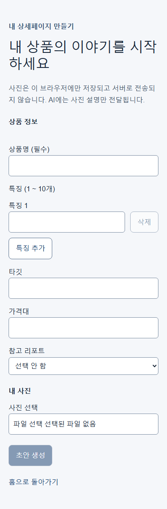
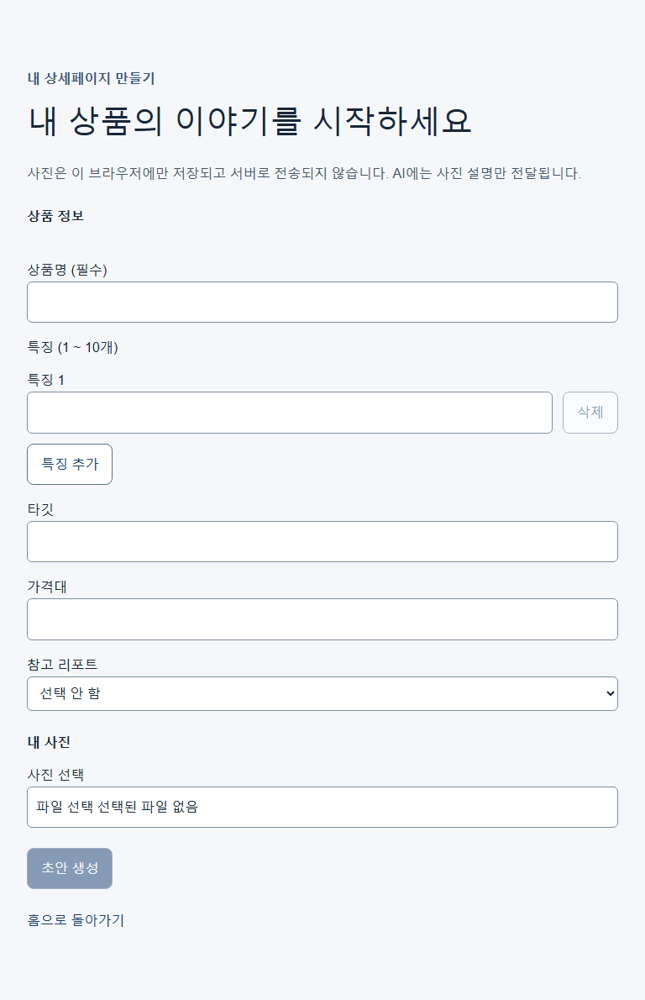
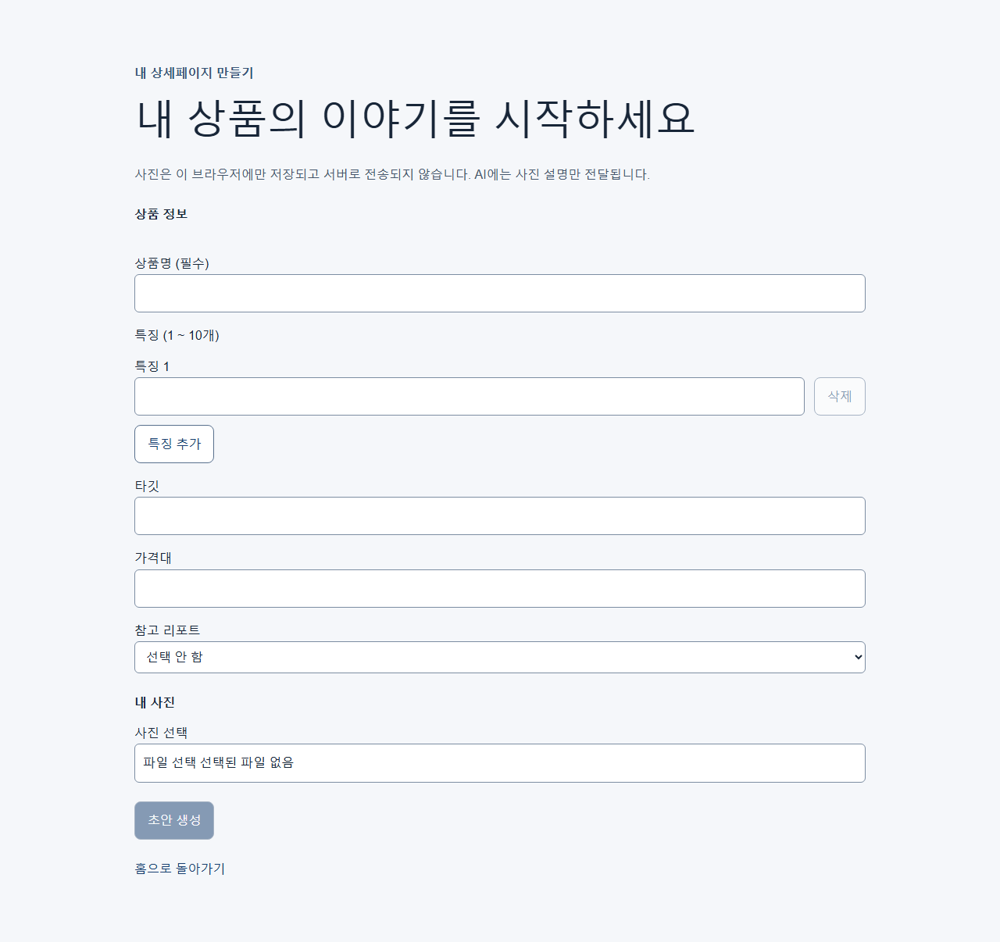
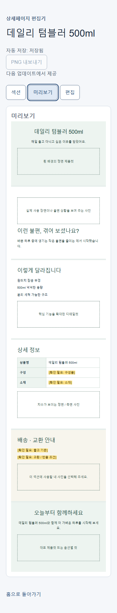
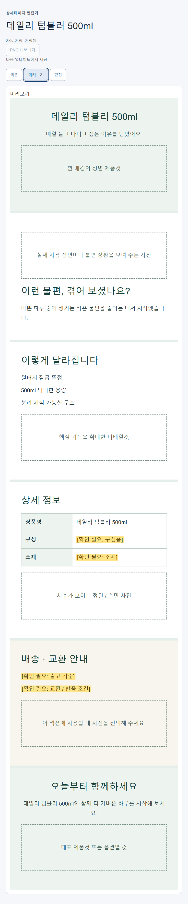
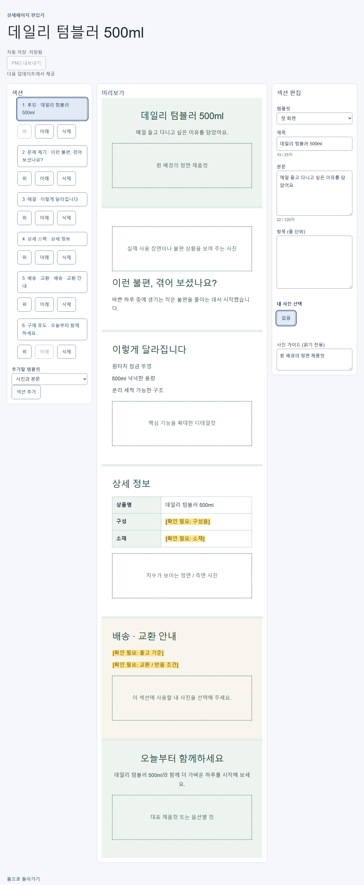
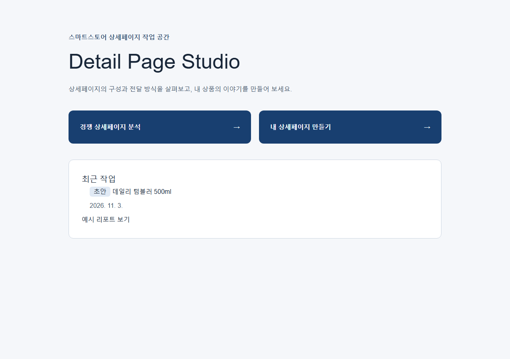
